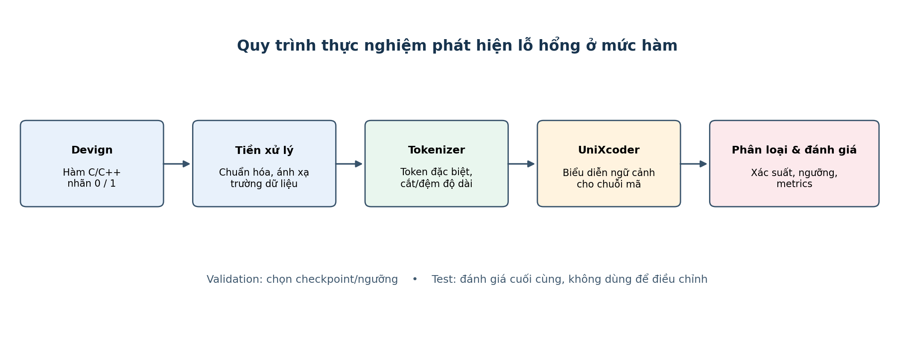
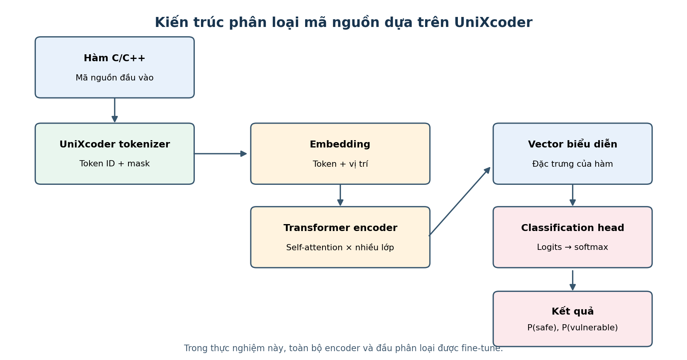
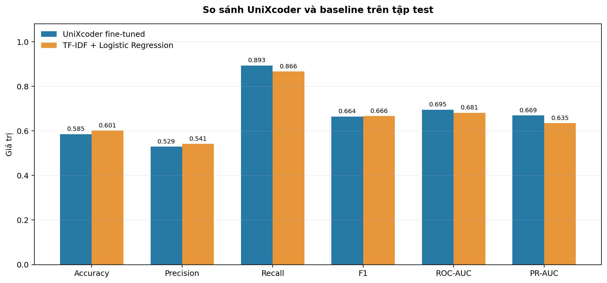
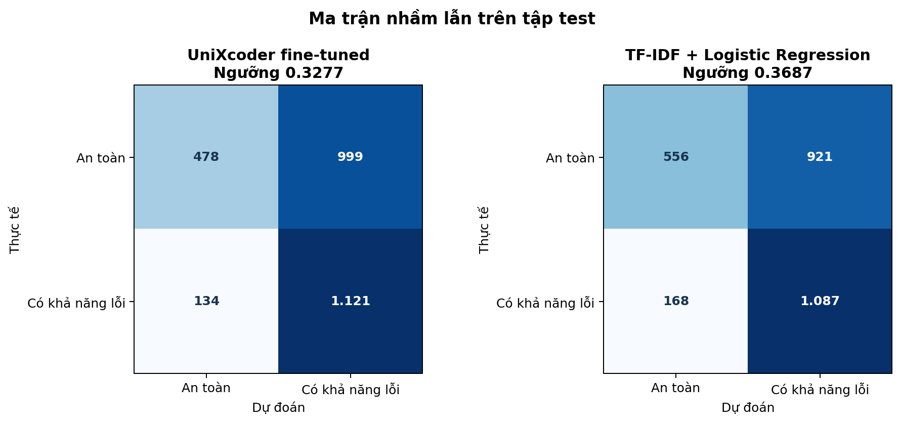

# CHƯƠNG 3. ỨNG DỤNG UNIxCODER TRONG PHÁT HIỆN LỖI MÃ NGUỒN

Chương này trình bày thực nghiệm fine-tune toàn bộ UniXcoder trên bộ Devign để phân loại hàm C/C++ có khả năng chứa lỗ hổng. Mô hình được huấn luyện trên tập train bằng CPU, chọn checkpoint và ngưỡng bằng validation, sau đó đánh giá một lần trên test. Ngoài kết quả UniXcoder, chương xây dựng baseline TF-IDF kết hợp Logistic Regression, kiểm tra trùng lặp giữa các split và phân tích lỗi dự đoán.

Lần chạy được báo cáo ở đây là fine-tune toàn bộ encoder trên 21.854 mẫu train, không phải checkpoint demo đóng băng encoder trước đó. Dữ liệu, cấu hình huấn luyện, checkpoint, metric validation và kết quả test của lần chạy này được lưu trong workspace. Các kết quả dưới đây vì vậy phản ánh trực tiếp lần thực nghiệm full fine-tuning trên CPU.

## 3.1. Môi trường thực nghiệm

### 3.1.1. Phần cứng

Lần fine-tuning và đánh giá được thực hiện trên máy tính cá nhân sử dụng bộ xử lý Intel Core i5-11300H thế hệ thứ 11, bộ nhớ RAM 16 GB và đồ họa tích hợp Intel Iris Xe. Máy không có GPU NVIDIA tương thích CUDA. PyTorch được cài ở bản CPU, do đó toàn bộ phép tính huấn luyện và suy luận chạy trên CPU.

Cấu hình phần cứng được giữ ổn định trong suốt thí nghiệm. RAM 16 GB đủ cho batch train kích thước 4; tuy nhiên, fine-tune Transformer yêu cầu lan truyền xuôi và ngược qua nhiều lớp, khiến lần chạy 3 epoch mất khoảng 63 giờ. Thời gian này ảnh hưởng đến khả năng lặp lại thí nghiệm, nhưng không phải chỉ số chất lượng mô hình.

| Thành phần | Cấu hình ghi nhận |
|---|---|
| CPU | Intel Core i5-11300H |
| RAM | 16 GB |
| GPU | Intel Iris Xe tích hợp; không có CUDA |
| Nền tảng tính toán của PyTorch | CPU |
| Thiết bị dùng khi huấn luyện và đánh giá | CPU |

Đồ án có thể sử dụng GPU đám mây để rút ngắn thời gian fine-tuning. Nếu thuê GPU, cần ghi lại chính xác loại GPU, bộ nhớ VRAM, thời điểm thuê và cấu hình phần mềm. Không nên chỉ ghi chung là “GPU cloud”, bởi tốc độ huấn luyện phụ thuộc vào GPU thực tế, giới hạn CPU/RAM và cách cấp phát tài nguyên. Máy GPU là phương tiện rút ngắn thời gian thực nghiệm, không tự làm tăng chất lượng mô hình nếu dữ liệu, quy trình huấn luyện và cách đánh giá không thay đổi.

### 3.1.2. Phần mềm

Lần fine-tuning và đánh giá cuối sử dụng Python 3.12.10, PyTorch 2.12.0+cpu và Transformers 5.13.1. Mô hình nền cùng tokenizer được tải từ microsoft/unixcoder-base; checkpoint báo cáo được tạo trong lần fine-tuning này và lưu tại outputs/devign_full_ft_cpu/checkpoint-best-f1/model.bin. Mã nguồn, cấu hình và kết quả được lưu trong workspace để có thể truy nguyên lần chạy.

Ứng dụng được xây dựng bằng Python. Mã chạy thực nghiệm nằm trong thư mục code, dữ liệu chuẩn hóa được lưu ở định dạng JSONL, kết quả tổng hợp được lưu thành JSON và dự đoán từng mẫu thành CSV. Streamlit cung cấp giao diện trình diễn gồm trang phân tích hàm, so sánh trước/sau bản vá và dashboard kết quả. Giao diện là lớp sử dụng mô hình; các số liệu đánh giá trong chương được sinh từ tập dữ liệu và script đánh giá, không được nhập thủ công vào giao diện.

| Phần mềm/thành phần | Phiên bản hoặc định danh | Vai trò |
|---|---|---|
| Python | 3.12.10 | Ngôn ngữ triển khai |
| PyTorch | 2.12.0+cpu | Tensor, suy luận và huấn luyện |
| Transformers | 5.13.1 | UniXcoder, cấu hình mô hình và tokenizer |
| Mô hình nền | microsoft/unixcoder-base | Biểu diễn mã nguồn |
| scikit-learn | Theo requirements của dự án | Tính các độ đo phân loại |
| pandas | Theo requirements của dự án | Lưu và phân tích dự đoán |
| PyArrow | Theo requirements của dự án | Đọc dữ liệu parquet |
| Streamlit | Theo requirements của dự án | Giao diện ứng dụng |

Các phiên bản thư viện nên được khóa trong môi trường tái lập trước khi chạy huấn luyện trên máy thuê. Khi thay đổi phiên bản PyTorch hoặc Transformers, cần lưu lại tệp phụ thuộc đã cài và kiểm tra khả năng tải checkpoint. Khác biệt phiên bản có thể ảnh hưởng đến API, kiểu tensor, tốc độ hoặc định dạng lưu trọng số. Mã nguồn và checkpoint cũng nên được lưu ở hai vị trí độc lập để việc khởi tạo lại máy không làm mất kết quả.

### 3.1.3. Các thư viện sử dụng

PyTorch thực hiện phép tính tensor, lan truyền xuôi và các thao tác tối ưu hóa tham số. Trong lượt đánh giá hiện tại, PyTorch được dùng cho suy luận trên CPU. Nếu fine-tuning trên máy có CUDA, cùng pipeline có thể lựa chọn CUDA thông qua kiểm tra thiết bị sẵn có. Transformers cung cấp lớp mô hình UniXcoder, tokenizer tương ứng và cấu hình kiến trúc. Việc dùng tokenizer đi kèm đúng mô hình là quan trọng vì token ID được ánh xạ theo từ vựng và quy ước tiền xử lý cụ thể.

Scikit-learn được sử dụng để tính accuracy, precision, recall, F1-score, ROC-AUC, PR-AUC và ma trận nhầm lẫn. Pandas hỗ trợ tổ chức xác suất dự đoán và nhãn thật theo từng mẫu để xuất CSV, phục vụ kiểm tra các false positive và false negative. PyArrow đọc các bản phân phối parquet của Devign. Streamlit xây dựng giao diện để người dùng nhập mã nguồn, xem xác suất dự đoán và xem kết quả đánh giá. Các thư viện này có chức năng riêng; không thư viện nào thay thế bước xác nhận thủ công hoặc phân tích bảo mật chuyên sâu.

## 3.2. Bộ dữ liệu thực nghiệm

### 3.2.1. Giới thiệu bộ dữ liệu

Thực nghiệm sử dụng Devign trong benchmark CodeXGLUE cho nhiệm vụ phát hiện mã lỗi/lỗ hổng [2], [3]. Bài toán là phân loại nhị phân ở mức hàm: đầu vào là mã nguồn C/C++, đầu ra là nhãn 0 (an toàn theo nhãn dữ liệu) hoặc 1 (được gán nhãn có khả năng không an toàn). Nhãn nhị phân không xác định chính xác CWE hay dòng mã gây lỗi.

Bộ dữ liệu dùng trong lần chạy có 27.318 mẫu, gồm 21.854 mẫu train, 2.732 validation và 2.732 test. Tệp train.jsonl được tạo từ phần bù các chỉ mục train sau khi xác nhận chỉ mục của hai tệp validation và test khớp với bản dữ liệu gốc. Mỗi dòng JSONL có mã hàm, nhãn, chỉ mục; một số bản ghi còn có tên dự án và commit_id.

| Split | Số mẫu | An toàn (target=0) | Có khả năng lỗi (target=1) | Vai trò |
|---|---:|---:|---:|---|
| Train | 21.854 | 11.836 | 10.018 | Cập nhật trọng số |
| Validation | 2.732 | 1.545 | 1.187 | Chọn checkpoint và ngưỡng |
| Test | 2.732 | 1.477 | 1.255 | Đánh giá cuối |
| Tổng | 27.318 | 14.858 | 12.460 | |

### 3.2.2. Tiền xử lý dữ liệu

Pipeline đọc trường func và target, chuẩn hóa khoảng trắng liên tiếp, token hóa bằng tokenizer đi kèm UniXcoder, rồi tạo chuỗi gồm token bắt đầu, token chế độ encoder, token phân cách và các token mã nguồn. Với block size 512, tối đa 508 token mã được giữ lại; phần còn thiếu được đệm. Hàm vượt giới hạn bị cắt ở cuối chuỗi. Nhãn 0/1 được giữ làm mục tiêu phân loại và idx được lưu cùng dự đoán để truy nguyên mẫu.

Trong tập test, 855/2.732 hàm (31,3%) vượt giới hạn token và bị cắt theo bộ đếm của tokenizer. Tỷ lệ này được ghi nhận để phân tích giới hạn ngữ cảnh; việc bị cắt không tự chứng minh nguyên nhân của dự đoán sai.

### 3.2.3. Chia tập Train/Validation/Test

Thí nghiệm giữ nguyên split chuẩn của CodeXGLUE: train dùng để học, validation dùng để chọn checkpoint và ngưỡng, test chỉ dùng cho báo cáo cuối. Không dùng test để điều chỉnh trọng số hay ngưỡng.

Kiểm toán hash chính xác trên chuỗi func phát hiện 8 hàm trùng giữa train/validation, 4 giữa train/test và 1 giữa validation/test. Các cặp trùng này có nhãn trái ngược nhau. Năm mẫu test trùng chính xác với train hoặc validation; khi loại riêng năm mẫu này để kiểm tra độ nhạy, F1 UniXcoder thay đổi từ 0,6643 lên 0,6645. Vì vậy kết quả chính vẫn báo cáo trên toàn bộ split benchmark để giữ khả năng đối chiếu, đồng thời công khai nguy cơ nhiễu nhãn và trùng lặp.

Hai dự án FFmpeg và qemu xuất hiện ở cả ba split. Do đó đây là đánh giá theo split hàm của benchmark, không phải đánh giá tổng quát hóa sang dự án chưa từng thấy. Các kết quả không nên được diễn giải như bằng chứng hiệu quả trên dự án mới hoặc hệ thống sản xuất.

## 3.3. Xây dựng mô hình phát hiện lỗi

### 3.3.1. Quy trình thực nghiệm

Quy trình gồm: (1) nạp ba split Devign và kiểm tra trường dữ liệu; (2) chuẩn hóa mã, token hóa và tạo batch; (3) khởi tạo UniXcoder cùng đầu phân loại; (4) fine-tune trên train; (5) đánh giá sau mỗi epoch trên validation để lưu checkpoint có F1 cao nhất tại ngưỡng 0,5; (6) dùng checkpoint tốt nhất để tìm ngưỡng F1 tối ưu trên validation; (7) khóa ngưỡng và đánh giá test đúng một lần; (8) lưu metric và dự đoán theo từng mẫu.

**Hình 3.1.** Quy trình fine-tuning và đánh giá. Tập test không tham gia chọn checkpoint hoặc ngưỡng.

### 3.3.2. Fine-tuning UniXcoder

UniXcoder cung cấp biểu diễn ngữ cảnh cho chuỗi mã nguồn. Trong thí nghiệm này, mô hình được khởi tạo từ microsoft/unixcoder-base và bổ sung đầu phân loại hai lớp. Khác với checkpoint demo trước đó dùng encoder đóng băng, lần chạy này cập nhật cả trọng số encoder Transformer lẫn đầu phân loại. Hàm mất mát cross-entropy so sánh logits với nhãn an toàn/có khả năng lỗi; AdamW cập nhật trọng số theo gradient.

Việc fine-tune toàn bộ encoder cho phép biểu diễn nền thích nghi với Devign, nhưng làm chi phí tính toán tăng mạnh. Do máy không có GPU CUDA, toàn bộ lần chạy sử dụng CPU và mất khoảng 63 giờ. Thời gian này phản ánh phần cứng và cấu hình cụ thể, không phải đặc tính cố định của UniXcoder.

**Hình 3.2.** UniXcoder tokenizer, encoder được fine-tune và đầu phân loại nhị phân.

### 3.3.3. Thiết lập tham số huấn luyện

| Tham số | Giá trị đã dùng |
|---|---:|
| Mô hình nền | microsoft/unixcoder-base |
| Mẫu train / validation / test | 21.854 / 2.732 / 2.732 |
| Số epoch | 3 |
| Block size | 512 token |
| Batch train | 4 |
| Tích lũy gradient | 4 batch |
| Batch hiệu dụng | 16 mẫu |
| Batch validation/test | 8 |
| Optimizer | AdamW |
| Learning rate | 2 × 10⁻⁵ |
| Seed | 42 |
| Số lần cập nhật optimizer | 4.098 |
| Thiết bị | CPU, PyTorch 2.12.0+cpu |

Checkpoint được chọn theo F1 validation tại ngưỡng mặc định 0,5 sau mỗi epoch. Sau khi huấn luyện, ngưỡng được quét riêng trên xác suất validation; ngưỡng đạt F1 cao nhất là 0,3277. Giá trị này được khóa trước khi tính metric test. Tách bước chọn checkpoint và bước hiệu chỉnh ngưỡng giúp ngăn test tham gia lựa chọn mô hình.

## 3.4. Đánh giá mô hình

### 3.4.1. Các độ đo đánh giá

Accuracy là tỷ lệ dự đoán đúng trên toàn bộ mẫu. Precision cho biết trong số các hàm bị cảnh báo, bao nhiêu hàm mang nhãn có khả năng lỗi; Recall cho biết mô hình tìm được bao nhiêu trong số các hàm dương tính. F1 là trung bình điều hòa giữa Precision và Recall. ROC-AUC và PR-AUC đánh giá khả năng xếp hạng xác suất qua nhiều ngưỡng; PR-AUC đặc biệt hữu ích khi lớp dương không chiếm toàn bộ dữ liệu. Ma trận nhầm lẫn được trình bày theo thứ tự lớp [an toàn, có khả năng lỗi].

Ngưỡng ảnh hưởng đến Precision, Recall, F1 và Accuracy nhưng không làm thay đổi ROC-AUC/PR-AUC. Trong báo cáo chính, mỗi mô hình chọn ngưỡng tối đa F1 trên validation rồi giữ nguyên trên test. Đây là một điểm vận hành tham khảo; khi triển khai cần chọn ngưỡng theo chi phí bỏ sót và chi phí rà soát cảnh báo.

### 3.4.2. Kết quả thực nghiệm

Checkpoint tốt nhất được lưu sau epoch thứ hai theo F1 validation tại ngưỡng 0,5. Sau đó, ngưỡng 0,3277 được chọn trên validation. Trên validation, ngưỡng này đạt F1 0,6487. Các chỉ số cuối trên test như sau:

| Mô hình | Ngưỡng chọn trên validation | Accuracy | Precision | Recall | F1 | ROC-AUC | PR-AUC |
|---|---:|---:|---:|---:|---:|---:|---:|
| UniXcoder fine-tuned | 0,3277 | 0,5853 | 0,5288 | 0,8932 | 0,6643 | 0,6946 | 0,6692 |
| TF-IDF + Logistic Regression | 0,3687 | 0,6014 | 0,5413 | 0,8661 | 0,6663 | 0,6812 | 0,6345 |

UniXcoder có Recall cao hơn 2,71 điểm phần trăm, ROC-AUC cao hơn 0,0133 và PR-AUC cao hơn 0,0347 so với baseline. Tuy nhiên, F1 thấp hơn 0,0020 và Accuracy thấp hơn khoảng 1,61 điểm phần trăm. Vì vậy kết quả này chưa chứng minh UniXcoder vượt baseline về mọi tiêu chí; hai mô hình có đánh đổi khác nhau. Chỉ có một seed, nên chênh lệch F1 nhỏ chưa đủ để khẳng định một mô hình tốt hơn.

Ma trận nhầm lẫn của UniXcoder ở ngưỡng 0,3277 là:

| Thực tế / dự đoán | An toàn | Có khả năng lỗi |
|---|---:|---:|
| An toàn | 478 | 999 |
| Có khả năng lỗi | 134 | 1.121 |

Trong 2.732 mẫu test, mô hình tạo 999 cảnh báo sai và bỏ sót 134 mẫu dương. Đây là lý do Recall cao cần được trình bày cùng Precision và khối lượng cảnh báo, thay vì dùng riêng F1 hoặc Recall để kết luận hiệu quả.

**Hình 3.3.** So sánh UniXcoder và baseline trên cùng test split; ngưỡng của từng mô hình được chọn riêng trên validation.

**Hình 3.4.** Ma trận nhầm lẫn tại ngưỡng validation-F1 của từng mô hình.

### 3.4.3. So sánh với mô hình khác

Baseline TF-IDF dùng word unigram/bigram với tối đa 200.000 đặc trưng, min_df=2, sublinear TF và Logistic Regression (solver liblinear, max_iter=1.000, random_state=42). Vectorizer và bộ phân loại chỉ được fit trên train. Ngưỡng 0,3687 được chọn từ validation; test không dùng để huấn luyện hoặc chọn ngưỡng. Cả baseline và UniXcoder dùng cùng các tệp train/validation/test.

Baseline có F1 0,6663, gần như bằng UniXcoder 0,6643, trong khi UniXcoder đạt ROC-AUC và PR-AUC cao hơn. Đây là đối chứng từ vựng đơn giản, không phải mô hình ngôn ngữ tiền huấn luyện khác như CodeBERT. Muốn kết luận ưu thế tương đối giữa các encoder cần bổ sung các baseline neural khác, cùng split, seed và quy trình chọn checkpoint.

## 3.5. Phân tích kết quả

### 3.5.1. Ưu điểm của UniXcoder

UniXcoder biểu diễn quan hệ giữa các token trong toàn bộ hàm thay vì chỉ đếm từ hoặc cụm từ. Trong thực nghiệm này, điều đó thể hiện ở ROC-AUC 0,6946 và PR-AUC 0,6692, cao hơn baseline TF-IDF lần lượt khoảng 0,0133 và 0,0347. Với ngưỡng chọn trên validation, Recall 0,8932 cũng cao hơn baseline 0,8661. Các kết quả gợi ý UniXcoder xếp hạng được một phần mẫu có tín hiệu lỗi tốt hơn theo các độ đo ngưỡng độc lập.

Pipeline được lưu thành mã có thể chạy lại: fine-tuning, chọn checkpoint, chọn ngưỡng trên validation, đánh giá test, lưu metric và dự đoán từng mẫu. Giao diện VulnScope có thể sử dụng checkpoint full fine-tuning ở cục bộ để trình diễn cùng cấu hình 512 token.

### 3.5.2. Hạn chế của mô hình và thực nghiệm

F1 của UniXcoder không vượt baseline TF-IDF trong lần chạy này. Precision 0,5288 đồng nghĩa gần một nửa cảnh báo trên test là false positive; có 999 false positive so với 1.121 true positive. Mô hình bỏ sót 134 mẫu dương. Ở ngưỡng 0,5, Recall giảm còn 0,7131, còn khi dùng ngưỡng F1 validation, Accuracy giảm còn 0,5853. Ngưỡng phản ánh đánh đổi vận hành, không sửa được lỗi xếp hạng hay nhãn dữ liệu.

Trong tập test, 855 hàm bị cắt ở 512 token. Trong nhóm false positive, 366/999 hàm bị cắt; trong false negative, 27/134 bị cắt. Đây là thống kê tương quan mô tả, chưa chứng minh cắt token gây ra lỗi dự đoán. Cần kiểm tra từng mẫu và thử giới hạn chuỗi khác trên validation.

Kiểm toán phát hiện một số hàm giống hệt nhau xuất hiện ở nhiều split nhưng mang nhãn trái ngược. Có 4 hàm trùng giữa train/test và 1 giữa validation/test; loại năm mẫu test trùng này chỉ đổi F1 UniXcoder từ 0,6643 thành 0,6645. Ảnh hưởng số học nhỏ trong lần chạy này nhưng mâu thuẫn nhãn làm tăng bất định. Ngoài ra, cả FFmpeg và qemu có mặt ở train, validation và test; kết quả không đo khả năng tổng quát hóa sang dự án mới.

Kết quả dựa trên một seed, một split benchmark và một cấu hình. Chưa có nhiều seed, baseline CodeBERT hoặc đánh giá trên dự án ngoài Devign. Nhãn Devign là ở cấp hàm và thiếu ngữ cảnh liên thủ tục; dự đoán không xác nhận một CWE, dòng gây lỗi hay khả năng khai thác thực tế. Phần giải thích token bằng occlusion chỉ cho biết độ nhạy của điểm số khi thay token, không phải lời giải thích nhân quả.

### 3.5.3. Hướng cải tiến

Ưu tiên đầu tiên là làm sạch dữ liệu và đánh giá độ bền. Có thể tạo split loại trừ trùng lặp theo hash, giữ các phiên bản gần nhau cùng một nhóm, và đánh giá theo dự án hoặc trên bộ dữ liệu độc lập. Nếu dùng split theo dự án, cần bổ sung đủ dự án để kết quả không phụ thuộc vào một dự án đơn lẻ. Mọi biến thể split phải được công bố riêng, không thay thế âm thầm split benchmark.

Tiếp theo, chạy nhiều seed và báo cáo trung bình cùng độ lệch chuẩn hoặc khoảng tin cậy. So sánh UniXcoder với CodeBERT và baseline truyền thống trên cùng dữ liệu, seed, độ dài đầu vào và cách hiệu chỉnh ngưỡng. Thử block size 128/256/512, ghi tỷ lệ bị cắt và chọn cấu hình bằng validation. Có thể thử class weighting hoặc focal loss nếu mục tiêu giảm false negative, nhưng mọi thay đổi phải được quyết định bằng validation.

Ngưỡng nên gắn với mục đích sử dụng. Với công cụ sàng lọc, có thể đặt Recall mục tiêu rồi đo số cảnh báo trên mỗi nghìn hàm; với quy trình rà soát hạn chế nhân lực, cần kiểm soát Precision hoặc top-k. Có thể kết hợp UniXcoder với static analyzer để xếp hạng cảnh báo, sau đó xác nhận bằng quy tắc hoặc chuyên gia. Giao diện cần luôn ghi rõ checkpoint, ngưỡng và giới hạn dự đoán.

## 3.6. Kết luận Chương 3

Chương này đã mô tả môi trường CPU, bộ dữ liệu Devign gồm 21.854 mẫu train, 2.732 validation và 2.732 test, cùng pipeline fine-tune toàn bộ UniXcoder trong 3 epoch với block size 512. Checkpoint tốt nhất được chọn trên validation; ngưỡng 0,3277 được tối ưu riêng trên validation rồi khóa trước đánh giá test.

Trên test, UniXcoder đạt F1 0,6643, Recall 0,8932, ROC-AUC 0,6946 và PR-AUC 0,6692. Baseline TF-IDF + Logistic Regression đạt F1 0,6663. UniXcoder có độ bao phủ và AUC cao hơn, nhưng F1 và Accuracy không cao hơn baseline trong cấu hình đã thử. Ma trận nhầm lẫn cho thấy còn 999 cảnh báo sai và 134 mẫu dương bị bỏ sót.

Kiểm toán cũng ghi nhận năm mẫu test trùng chính xác với train hoặc validation và các split dùng chung dự án. Tác động số học của năm mẫu trùng nhỏ, nhưng đây là hạn chế cần công khai; kết quả chưa đại diện đánh giá cross-project. Vì vậy VulnScope nên được xem là công cụ hỗ trợ sàng lọc, không thay thế phân tích tĩnh hay chuyên gia. Các bước tiếp theo là làm sạch split, chạy nhiều seed, bổ sung baseline encoder khác và thử nghiệm trên dữ liệu độc lập.

## Tài liệu tham khảo của chương

[1] D. Guo, S. Lu, N. Duan, Y. Wang, M. Zhou, J. Yin, “UniXcoder: Unified Cross-Modal Pre-training for Code Representation,” Proceedings of ACL, 2022. https://arxiv.org/abs/2203.03850

[2] Y. Zhou, S. Liu, J. Siow, X. Du, Y. Liu, “Devign: Effective Vulnerability Identification by Learning Comprehensive Program Semantics via Graph Neural Networks,” NeurIPS, 2019. https://arxiv.org/abs/1909.03496

[3] Microsoft, “CodeXGLUE — Defect Detection,” tài liệu benchmark và split Devign. https://github.com/microsoft/CodeXGLUE/tree/main/Code-Code/Defect-detection

[4] VulnScope, “UniXcoder Devign Checkpoint Model Card,” cấu hình demo và phạm vi sử dụng checkpoint. https://huggingface.co/vinh204/vulnscope-unixcoder-devign
